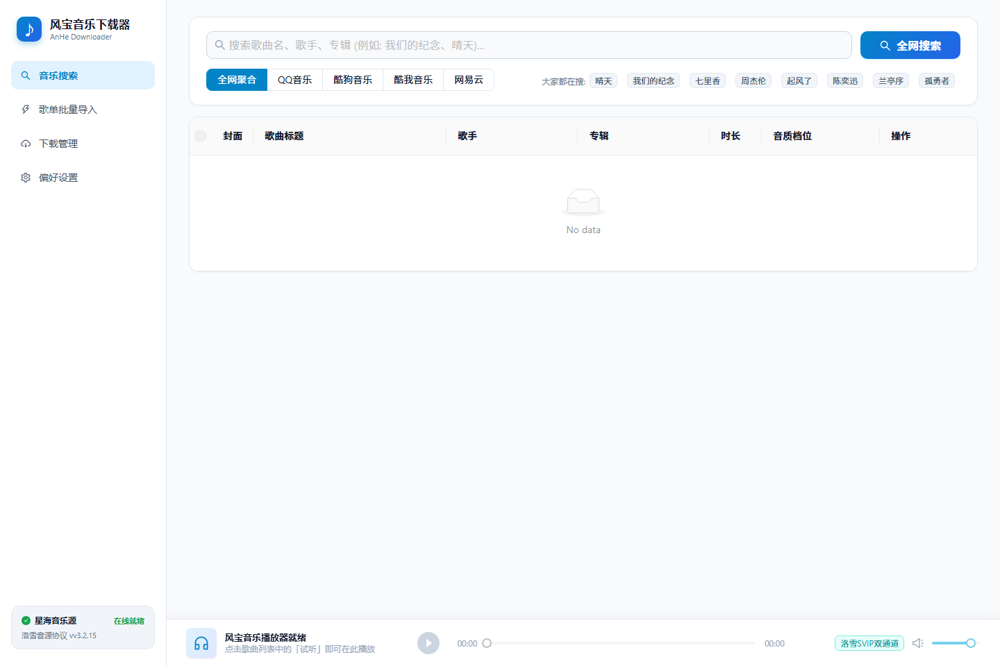

<p align="center">
  
</p>

<h1 align="center">风宝音乐下载器 · AnHe Music Downloader</h1>

<p align="center">
  
  
  
  
  
</p>

<p align="center">
  基于 <b>Go + 原生 Edge WebView2 + React 18</b> 的轻量 Windows 桌面音乐下载器<br>
  多源聚合检索 · 歌单批量导入 · 单文件 MP3 自动内嵌 500×500 封面与滚动歌词
</p>

---



## 📖 简介

风宝音乐下载器是一个面向 Windows 10/11 的轻量桌面应用：

- 后端使用 Go 编写，编译为**单个 exe**（约 9.3MB），前端资源通过 `go:embed` 打包进二进制；
- 界面基于原生 WebView2，启动快、内存占用低，不需要安装 Electron 或额外浏览器；
- 下载结果默认整理成**一份 MP3**：标题 / 歌手 / 专辑 + 500×500 封面 + `USLT` 歌词 + `SYLT` 同步滚动歌词（ID3v2.3）；
- 支持洛雪（LX Music）自定义音源脚本，可上传、持久化、随时恢复；
- 音源解析全部在本地后端完成，规避第三方接口 CORS 限制，并自动过滤 VIP 试听占位片段。

> 本项目仅供个人学习与音频技术研究使用，请勿用于商业传播。详见[免责声明](#-免责声明)。

---

## ✨ 核心特性

- 🚀 **轻量原生架构**：Go + WebView2 单文件桌面程序，双击即用，无控制台黑框。
- 🔍 **多源聚合搜索**：QQ 音乐、网易云、酷我、酷狗单源检索与全网聚合去重。
- ⚡ **异步流式下载**：1~5 并发、实时进度与速率、临时文件 + 原子重命名。
- 🏷️ **单文件 MP3**：ID3v2.3 标签、`USLT` + `SYLT` 歌词、`APIC` 高清封面，兼容 Windows / 车载播放器。
- 🎼 **洛雪音源沙箱**：模拟 `globalThis.lx`，上传校验、持久化保存、一键恢复内置音源。
- 🛡️ **解析兜底**：酷我 → 酷狗 → 网易云跨源匹配，自动拒绝 VIP 试听片段。
- 🎛️ **简洁 UI**：搜索 / 歌单导入 / 下载管理 / 设置，内置底部迷你试听播放器。

---

## 🖥️ 快速开始

1. 从 [Releases](https://github.com/raclen/anhe-downloader/releases) 下载最新的 `anhe-downloader.exe`；
2. 放到任意可写目录，双击运行（或双击 `启动.bat`）；
3. 搜索歌曲 → 勾选下载 → 在「下载管理」查看进度。

无窗口 / 浏览器模式：

```bash
anhe-downloader.exe -headless -port 45678
```

然后浏览器打开 `http://127.0.0.1:45678`。

> Windows 10 / 11 已内置 Edge WebView2 运行时，一般无需额外安装。

---

## 📚 文档导航

| 文档 | 内容 |
| --- | --- |
| [使用指南](docs/USAGE.md) | 搜索、下载、歌词封面、设置项、音源脚本 |
| [构建与开发](docs/BUILD.md) | 环境要求、前端构建、Go 编译、调试与发布 |
| [本地 API](docs/API.md) | 所有 HTTP 接口的参数、响应与错误约定 |
| [常见问题](docs/FAQ.md) | 封面/歌词不显示、VIP 曲目、音源失效等 |
| [更新日志](CHANGELOG.md) | 版本变更记录 |
| [开发约束](PROJECT_RULES.md) | 架构边界、音源现状、接口备忘与踩坑记录 |

---

## 🛠️ 项目结构

```text
anhe-downloader/
├── main.go                       # 桌面宿主：嵌入 dist、WebView2 窗口、启动本地服务
├── internal/
│   ├── downloader/               # 下载引擎、歌词/封面抓取、ID3v2.3 与 FLAC 标签写入
│   └── server/                   # HTTP API、多源搜索、统一解析、音源脚本管理
├── frontend/                     # React 18 + TypeScript + Ant Design 5
│   ├── src/
│   └── dist/                     # 构建产物（已内嵌进 exe）
├── docs/                         # 使用 / 构建 / API / FAQ 文档
├── winres/                       # Windows 图标资源
├── rsrc_windows_*.syso           # 编译进 exe 的图标与版本信息
├── 启动.bat
├── go.mod
├── README.md
├── CHANGELOG.md
├── PROJECT_RULES.md
└── LICENSE
```

> 仓库**不附带**第三方音源脚本。运行时可将自行获取的 `.js` 音源放到程序目录，或通过设置页上传。

---

## ⚠️ 已知限制

- **VIP / 付费曲目**：各平台免费接口通常只返回短试听片段，解析器会拒绝并提示换源。
- **第三方音源服务不稳定**：外部直链服务可能随时失效，程序会自动回退到内置跨源解析。
- **仅支持 Windows 桌面**：Linux/macOS 可尝试 `-headless` 模式自行构建。

更多细节见 [常见问题](docs/FAQ.md)。

---

## ⚖️ 免责声明

1. 本软件仅供个人学习、技术研究与音频技术交流使用。
2. 音频、封面、歌词等内容的版权均归原权利人所有。
3. 请在法律法规允许的范围内合理使用，请勿用于商业盈利或非法传播。
4. 使用者需自行承担因使用本软件产生的一切后果。

---

## 🤝 鸣谢

- [LX Music Desktop（洛雪音乐助手）](https://github.com/lyswhut/lx-music-desktop)
- [go-webview2](https://github.com/jchv/go-webview2)
- [go-flac](https://github.com/go-flac/go-flac)
- [OuterTune](https://github.com/OuterTune/OuterTune)

---

## 📄 开源许可证

本项目基于 [MIT License](LICENSE) 开源。
